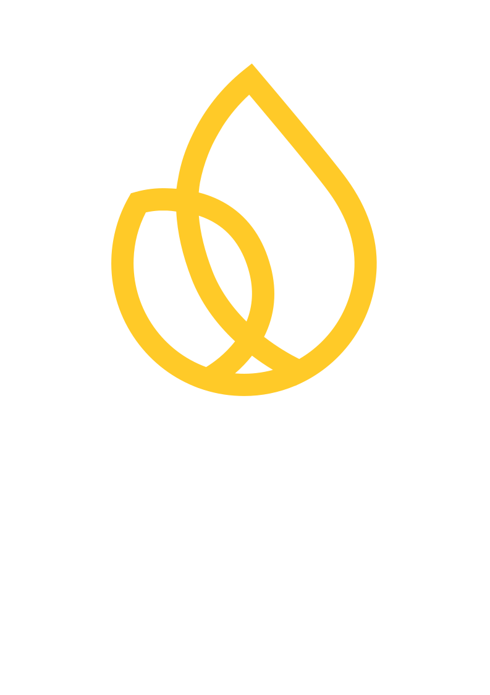

<h1 align="left">Hey, I'm Shoury 👋</h1>

### Backend & Systems Engineering · Go · Python · PostgreSQL

I'm a Computer Science undergraduate from New Delhi, India, interested in building reliable backend systems and understanding the engineering underneath them.

I started out exploring web development, but gradually found myself more interested in what happens behind the interface, API design, databases, concurrency, networking, process management, and system reliability.

I primarily work with <strong>Python</strong>, <strong>Django</strong>, and <strong>PostgreSQL</strong>, while building deeper experience with <strong>Go</strong> and systems programming. I enjoy working on problems where thoughtful engineering matters more than adding another layer of abstraction.

---

### 🛠️ A little about my work

- **Backend SDE Intern** at **Slotin Solutions** *(Oct 2025 – Apr 2026)*
  - Contributed **130+ merged PRs** across multiple codebases.
  - Worked on backend migrations involving **Firebase Realtime Database**, **PostgreSQL**, and custom **Django OTP authentication** for a product serving **6,500+ users**.
  - Implemented **role-based access control (RBAC)** across **100+ API endpoints** and contributed to subscription and configuration systems.
- Contributed to open-source projects and participated in developer communities and collaborative initiatives.

---

### 🏆 Highlights

- **2nd Place** — Azinhack'25 *(IoSC, GGSIPU-EDC)*
- **Open Source** — Top 2.5% Contributor in GSSoC · Top 50 Contributor in SSoC

---

### 💻 Tech I work with

---

### 🔍 What I'm interested in

- Backend and platform engineering
- Distributed systems, concurrency, and networking
- Operating systems and systems programming
- Database internals, data modelling, and performance
- Developer tools, workflow orchestration, and infrastructure
- Cloud computing and deployment

> Currently spending more time with **Go**, **Linux**, and **systems-level concepts**, while continuing to strengthen my backend engineering fundamentals.

---

### 🤝 Let's connect

I'm always open to interesting engineering discussions, open-source collaboration, and connecting with people who enjoy building things.

  
  
  

---

 

